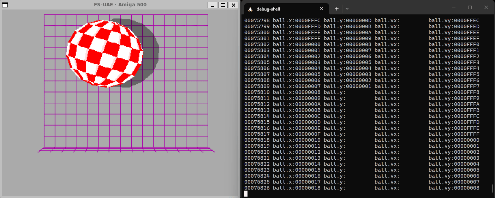

# Debug Shell for FS-UAE



An interactive Python wrapper around the **FS-UAE console debugger** on Linux. Only the forked [FS-UAE version 3.3.0](https://github.com/Robbson/fs-uae) and above is supported because it has mandatory fixes to make the wrapper work. It keeps the native debugger fully usable while adding automation for memory watchpoints: parsing debugger output and logging watchpoint hits to a CSV file.

The wrapper is an automation layer built on top of the existing debugger. It does not reimplement or reinterpret native debugger commands.

## Requirements

- Linux with a POSIX terminal
- [uv](https://docs.astral.sh/uv/)
- [FS-UAE >=3.3.0](https://github.com/Robbson/fs-uae) (`fs-uae` on `PATH`) and a working X display (`DISPLAY`)

## Install

Clone this repository:
```sh
git clone https://github.com/Robbson/fs-uae-debug-shell.git
cd fs-uae-debug-shell
```

Install all Python dependencies:
```sh
uv sync
```

Make the tool globally available on your system:
```sh
uv tool install --editable .
```

## Usage

Launch FS-UAE through the wrapper, passing the FS-UAE arguments after `--`:

```sh
debug-shell -- ./demo/Boing.fs-uae
```

FS-UAE starts the emulator normally. The debugger is by default **not** active at startup, so the wrapper cannot interact until you activate it:

1. When the game is running, press **F12 + D** in the FS-UAE window.
2. FS-UAE prints `WARNING: Activated debugger`, a register dump, and the interactive `>` prompt; the wrapper raises its own `> ` prompt at that point.

With `--startdebug` the wrapper activates the debugger for you instead, so it is ready at the prompt from the very beginning (see below).

From here the debugger behaves as usual. While the game is running FS-UAE's debugger accepts no console input, so the wrapper shows no prompt, and debugger output is written straight to the terminal rather than repainted above an active prompt.

Shell-specific commands use the reserved prefix `:` (configurable with `--prefix`). They are intercepted by the wrapper and never reach the emulator; every other line is forwarded to FS-UAE unchanged.

The input line is provided by [`prompt_toolkit`](https://python-prompt-toolkit.readthedocs.io/), so it supports cursor movement (Left/Right), Home/End, Backspace/Delete, and command history with the Up/Down arrows. Press **Tab** for completion of shell command names and their parameters (`:output shell|log|both`, `:showdump on|off`, `:logfile` paths). History is kept in memory for the current session. In `shell`/`both` mode the prompt is shown only while the debugger is at its `>` prompt; in `log` mode it stays up while the game runs so the status line keeps showing progress. Shell commands (including `:quit`) are available once the debugger is active.

### Options

```
--fsuae PATH             FS-UAE executable to launch (default: fs-uae)
--config PATH            watchpoint scenario file (default: ./config.yaml when present)
--prefix CHAR            shell command prefix (default: :)
--startdebug [MS]        activate the debugger at startup, after an optional
                         delay in milliseconds (forked FS-UAE only)
-v, --verbose            debug-level wrapper diagnostics
```

### Start the debugger at startup

The forked FS-UAE build (3.3.0 and above) can enter its debugger when it receives `SIGUSR1`, so you do not have to press F12+D. `--startdebug` uses this: the wrapper launches FS-UAE with `--console_debugger=1 --debugger_signal=1` (any of these you pass yourself is left unchanged) and, once FS-UAE prints its `debugger_signal: sending SIGUSR1 will activate the debugger` marker, sends the signal to the child. The order matters: signalling before FS-UAE installs the handler would kill the process, which is why the wrapper waits for that marker.

```sh
debug-shell --startdebug -- ./demo/Boing.fs-uae
```

The emulator boots at the loaded point, the debugger activates on the next frame, and the wrapper's `> ` prompt appears as soon as FS-UAE prints its own. Without `--startdebug` the wrapper behaves exactly as before and waits for F12+D. `SIGUSR1` is only available on POSIX hosts and only in the forked build; on anything else FS-UAE rejects the added options or never prints the marker, and you fall back to F12+D.

Pass a delay to let the emulator run first — for example to get past a level that is still loading before you take control:

```sh
debug-shell --startdebug 5000 -- ./demo/Boing.fs-uae
```

The value is a whole number of milliseconds and is measured from the signal-ready marker, not from process start, so the safety rule above still holds and a small value is safe. `--startdebug` with no value (or `0`) activates as soon as the marker arrives; the delay is capped by nothing but is cancelled if the emulator exits first.

## Shell commands

| Command | Description |
| --- | --- |
| `:help` | Show the command list. |
| `:status` | Show debugger state, output mode, log file, and counters. |
| `:output shell\|log\|both` | Route all watchpoint hits (default: `shell`). |
| `:logfile <file>` | Set the CSV log file name. |
| `:framevalues first\|last\|all` | Keep which write of each frame per watchpoint (default: `first`; ignored for classic output). |
| `:frameagg on\|off` | Condense each frame into one row of watchpoint values (default: `on`). |
| `:showdump on\|off` | Show the debugger's CPU register dump on each stop (default: `on`). |
| `:<address>[, <address>[ <length>] ...]` | Add quick watchpoints by address (aliased by the address) using the `config.yaml` defaults. |
| `:sci [add\|rm <scenario> ...]` | Activate or remove watchpoint scenarios from `config.yaml` (`*` selects every scenario; no argument lists the active ones). |
| `:quit` | Stop the emulator and exit the shell. |

## Output routing

`:output` decides where **all** watchpoint hits go:

| Mode | Behaviour |
| --- | --- |
| `shell` | Show watchpoint hits on the terminal (default). |
| `log` | Hide watchpoint output on the terminal and write it to the CSV file. |
| `both` | Show watchpoint hits and write them to the CSV file. |

In `log` mode nothing from a watchpoint hit reaches the screen, so the shell keeps a fixed status line at the bottom with the running total of logged events and a counter per watchpoint. Because the hit block is hidden there, the prompt and that status line stay up while the game runs, so the counter is continuously visible and updates on every hit; a hit that is only logged still stops the emulator, exactly as the native debugger does.

`:logfile <file>` sets the CSV file name; the default is `output_<timestamp>.csv` (with milliseconds, so two sessions never collide). The file is created **lazily**, on the first hit that is actually logged: until then the chosen name only exists in memory. If a user-supplied name already exists, an increasing numeric suffix is appended (for example `report_1.csv`, `report_2.csv`) so earlier logs are never overwritten. Changing `:logfile` starts a new file on the next logged hit.

## Frame values (enhanced output)

FS-UAE's enhanced watchpoint-hit output prefixes every hit with a video-frame counter. A frame can contain several writes to the same watchpoint because the game loop runs more often than frames are rendered, but the screen shows only one of those values. `:framevalues` chooses which writes per frame and watchpoint are shown and logged:

| Value | Behaviour |
| --- | --- |
| `first` | Keep the first write of each watchpoint in a frame (default). |
| `last` | Keep the last write of each watchpoint in a frame. |
| `all` | Keep every write. |

The classic hit output has no frame counter, so `:framevalues` is ignored there and every hit is used. `:status` reports the current setting. For this enhanced stream:

```text
00000164 Memwatch 01: 00000574.W  W  00000003 PC=0000B8A6 CPUDW (000)
00000164 Memwatch 02: 00000576.W  W  00000093 PC=0000B8C2 CPUDW (000)
00000165 Memwatch 02: 00000576.W  W  00000094 PC=0000C28C CPUDW (000)
00000165 Memwatch 02: 00000576.W  W  00000095 PC=0000C28C CPUDW (000)
00000165 Memwatch 02: 00000576.W  W  0000008E PC=0000C968 CPUDW (000)
00000166 Memwatch 02: 00000576.W  W  0000008D PC=0000C28C CPUDW (000)
00000166 Memwatch 02: 00000576.W  W  00000088 PC=0000C28C CPUDW (000)
```

`first` keeps `00000003`, `00000093`, `00000094`, and `0000008D`; `last` keeps `00000003`, `00000093`, `0000008E`, and `00000088`; `all` keeps every line.

## Frame aggregation (enhanced output)

FS-UAE's enhanced hit output is a stream of one full `Memwatch` line per write. `:frameagg` (default `on`) offers an alternative, condensed view that keeps only the frame counter, the watchpoint ids, and their values; address, size, access, PC, and trailer are dropped. All the hits of a frame become one row, with one column per watchpoint, so the table grows wider as watchpoints are added:

```text
00000969 01:00000029 02:00000067
00000970 01:0000002C 02:00000068
```

A watchpoint that did not write in a frame keeps its column but leaves it blank, so a stale value can never be mistaken for a fresh one:

```text
00000969 01:         02:00000067
```

With active scenarios the columns are named by their aliases instead of `01`/`02` (see [Watchpoint scenarios](#watchpoint-scenarios)):

```text
00000969 ball.x:00000029 ball.y:00000067
```

The same view shapes the CSV log (see below): one row per frame with one column per watchpoint (aliases when configured, otherwise `wp<n>`) and an empty cell for a watchpoint that did not write.

Columns are the watchpoints the wrapper knows about — those defined with `w` (the debugger's `Memwatch breakpoint enabled` definition lines) plus any seen in a hit. Define your watchpoints before you start logging; a watchpoint that first appears after the aggregation header has been written is reported as a logging error and needs a new `:logfile`. `:frameagg` applies only to the enhanced output that carries a frame counter; the classic output without one is passed through unchanged. `:framevalues` still chooses which write of each frame and watchpoint is kept before aggregation.


## Alternative ways to add watchpoints

Typing `w <num> <address> <length> <flags>` for every watchpoint is repetitive and the numbers are easy to lose track of. Of course, you can also copy multiple watchpoint defintions (each in a separate line) from any text source to the shell. But the _Debug Shell_ has 2 alternative concepts to make this handling easier: _Watchpoint Scenarios_ & _Quick Watchpoints_.

### Watchpoint scenarios

A scenario names its watchpoints in `config.yaml` and lets the wrapper assign the numbers. Defaults keep the file short; an entry can override `length` or `flags`:

```yaml
memwatch:
  defaults:
    length: 2
    flags: [W, C, L]
  scenarios:
    ball:
      - name: ball.x
        address: "574"
      - name: ball.y
        address: "576"
      - name: ball.vx
        address: "580"
      - name: ball.vy
        address: "582"
    player1:
      - name: pl1.x
        address: "5C0"
        flags: [W, L]        # override the default flags
      - name: pl1.y
        address: "5B6"
      - name: pl1.aim
        address: "5B8"
      - name: pl1.fire
        address: "5BE"
        length: 1            # override the default length
```

The file is read from the folder you launch the wrapper in, or from the path given with `--config`. It is validated on startup; a malformed file or an unknown key aborts the wrapper with a message that names the location, for example:

```text
[wrapper] error: config.yaml: memwatch.scenarios.ball[1]: 'address' must be a hexadecimal string (quote it, e.g. "574")
```

A [`config.schema.json`](config.schema.json) is included for editor validation. Quote addresses, since YAML would otherwise read an unquoted `574` as a number.

Activate scenarios at the debugger prompt:

```text
:sci add ball
[wrapper] added scenarios:
  ball: 1=ball.x, 2=ball.y, 3=ball.vx, 4=ball.vy
```

The wrapper builds the native commands for you (the examples use the defaults above):

```text
w 1 574 2 W C L
w 2 576 2 W C L
w 3 580 2 W C L
w 4 582 2 W C L
```

`:sci add *` activates every scenario, `:sci add player1` keeps counting (`5`…`8`), `:sci rm <scenario>`/`:sci rm *` removes them (each watchpoint is removed with `w <num>`), and `:sci` with no argument lists the active scenarios and their assigned numbers. Numbers are never reused within a session.

Once a scenario is active its aliases replace the watchpoint numbers in the wrapper's **own** output — the condensed frame row, the CSV log, the status line and `:status`:

```text
00000969 ball.x:00000029 ball.y:00000067
```

Verbatim debugger lines (shown when `:frameagg off`) are never rewritten and keep the numbers the debugger printed.

### Quick watchpoints by address

For a fast look at a few addresses you do not need a scenario. Since no shell command starts with a number, a `:` followed by comma-separated addresses adds them directly, applying `memwatch.defaults` from `config.yaml`:

```text
:574, 576, 580
[wrapper] added watchpoints: 1=574, 2=576, 3=580
```

The wrapper assigns the numbers and sends the same native commands a scenario would:

```text
w 1 574 2 W C L
w 2 576 2 W C L
w 3 580 2 W C L
```

Each watchpoint is aliased by its bare address (`574`), so it appears as `574` rather than a number in the condensed output, the CSV log and the status line. The length may be overridden per address by writing it after the address; the flags always come from the defaults:

```text
:574, 576 4, 580
[wrapper] added watchpoints: 1=574, 2=576, 3=580
w 1 574 2 W C L
w 2 576 4 W C L
w 3 580 2 W C L
```

Addresses are hexadecimal and may use the debugger's `$` prefix or `0x` form (`:$574, 0x576`); they are stored and displayed without the prefix. Numbering continues from the last used number, so this mixes freely with `:sci`. There is deliberately **no** shorthand to remove them — it is a quick-testing aid. To remove one without restarting, use the debugger's own `w <num>` (list them with `:status`, which shows the debugger watchpoints, or the debugger's `w`). If `config.yaml` sets no `memwatch.defaults.flags`, or a length is needed and none is set and none was given, the command fails with a message and registers nothing.

## CPU register dump

When the debugger stops — on a manual activation (F12+D) or on a watchpoint break — FS-UAE prints a CPU register dump: a `-- stub -- activate_console` marker, the `D0`–`A7` register lines, `USP`/`ISP`, the status-register flags, the prefetch and disassembled instruction, and a closing `Next PC:` line:

```text
WARNING: Activated debugger
 -- stub -- activate_console
  D0 00000000   D1 00000000   D2 0000000F   D3 0000FFFF
  ...
Next PC: 0000c29c
>
```

`:showdump on|off` (default `on`) chooses whether this block is written to the terminal. With `off` it is removed from the screen, so repeated stops no longer scroll older output away; the `WARNING: Activated debugger` line and the watchpoint `Memwatch ...` line that introduce it are not part of the block and are still shown, and exception output such as a logging failure is never hidden. Only this automatically printed dump is matched: the dump printed by the `r` command has no stub marker and is forwarded unchanged. The setting affects the terminal only — it does not change what is logged, and emulation is still left stopped as usual.

## Logging

### Watchpoint logging workflow

Watchpoints are created with the native debugger command `w` (see the debugger's own `help`). The wrapper only *observes* them:

```text
w 0 $574 2 W
Memwatch breakpoints enabled
 0: 00000574 - 00000575 (2)  W  CPU
:output log
[wrapper] output: log
:logfile ball.csv
[wrapper] logfile: /path/to/ball.csv
g
```

From then on, every hit of every watchpoint is appended to `ball.csv` and hidden from the terminal, with per-watchpoint counters shown in the status line. A hit looks like this in the debugger output (confirmed against FS-UAE):

```text
Memwatch 0: break at 00000574.W  W  000000FB PC=0000B8A6 CPUDW (000)
```

A watchpoint hit stops the emulator at the debugger prompt, exactly as the native debugger does. The wrapper logs the hit and leaves control with you; emulation continues only when you send `g` (or another command) yourself.

### Log file format

CSV, UTF-8, append-only. A header row is written when the file is created or empty. Records are flushed immediately.

By default (one row per hit) the schema is:

```text
timestamp,frame,wp,address,size,access,value,pc
2026-10-10T21:14:35.165,25,0,0x00000574,W,W,0x00000080,0x0000C28C
```

| Column | Meaning |
| --- | --- |
| `timestamp` | ISO-8601 local time, without a timezone offset. |
| `frame` | Frame counter from FS-UAE's enhanced hit output (decimal); empty for the original format. |
| `wp` | Watchpoint id from the `Memwatch <n>:` line, or its scenario alias when one is active. |
| `address` | Watchpoint address (hex). |
| `size` | Access size as printed by the debugger (`B`/`W`/`L`). |
| `access` | Access type as printed by the debugger (`R`/`W`/`I`/`F`/`C`). |
| `value` | Value printed by the debugger (hex). |
| `pc` | Program counter at the break (hex). |

With `:frameagg on` and enhanced output, the file uses the wide frame-aggregation schema instead: one row per frame and one column per watchpoint. A watchpoint that did not write in a frame gets an empty cell. Columns use scenario aliases when one is active (`timestamp,frame,ball.x,ball.y`); otherwise they are `wp<n>`.

```text
timestamp,frame,wp1,wp2
2026-10-12T00:31:26.549,184,0x0000001D,0x00000060
2026-10-12T00:31:26.569,185,,0x00000061
```

The schema is fixed when the file is created, so toggling `:frameagg` (or switching between classic and enhanced output) while a file is open starts a new file on the next record.

Only fields present in the debugger's `Memwatch ...` line are recorded; the wrapper never fabricates values.

## Launch and attachment model

The wrapper **launches** FS-UAE and owns its console. Attaching to an already-running FS-UAE process is not supported: the debugger console is bound to the terminal FS-UAE was started from, and FS-UAE provides no way to attach to it afterwards. Always start FS-UAE through the wrapper.

If the wrapper's terminal goes away, the wrapper shuts down and terminates the FS-UAE child process so no emulator is left running unintentionally.

## Documentation

- [`docs/architecture.md`](docs/architecture.md) — module map, state model, data flow.
- [`docs/decisions.md`](docs/decisions.md) — why the structure and behaviour are as they are.
- [`docs/debug-shell-output.md`](docs/debug-shell-output.md) — the exact output formats captured from real FS-UAE sessions, including the raw fixtures used by the parser tests.
- [`CHANGELOG.md`](CHANGELOG.md) — what has changed.

## Testing

Unit tests (no emulator required):

```sh
uv run python -m unittest discover -s tests
```

They cover parsing (including partial/multi-line output), per-frame hit selection and frame aggregation, scenario configuration/validation and alias handling, CLI config resolution, command dispatch and completion, output routing and log-file naming, CSV creation/append/error handling (both schemas), console input state, and child-output handling. Parser tests use real captured output in `tests/fixtures/`.

### Checks

- `uv run python -m unittest discover -s tests` — 284 tests, all passing.
- `uvx ruff check .` — clean.
- No type checker (mypy/pyright) is configured in this project.

## Known limitations

- Only output formats confirmed against FS-UAE 3.3.0 or higher are parsed. Other versions or WinUAE differ.
- `--startdebug [MS]` needs the forked FS-UAE build and a POSIX host, because it activates the debugger with `SIGUSR1`. 
A signal-ready marker reaches the wrapper's console; the debugger is activated by the wrapper, so no keyboard interaction is needed. The optional delay is measured from that marker, so it cannot fire the signal before the handler is ready.
- Watchpoints are created with the native `w` command; the wrapper does not create them for you. A scenario or entering quick watchpoints, however, do: they build and send the `w` commands for their entries.
- The wrapper does not track watchpoints created manually with `w`. A scenario always assigns the next unused number, so activating one after manual `w` commands can overwrite a number you used by hand. Define scenarios and manual watchpoints so their numbers do not collide, or activate scenarios first.
- A watchpoint added with several flags (`w 1 574 2 W C L`) prints a definition line whose exact shape is not yet captured, and the parser only knows the single-flag definition form. Such definitions may be absent from `:status`; frame-aggregation columns are still learned from the hits themselves.
- Scenario configuration is validated at startup; an invalid `config.yaml` (or one passed with `--config`) aborts the wrapper with a located message.
- Frame aggregation needs FS-UAE's enhanced hit output (the leading frame counter); the classic output is passed through unchanged. Its CSV columns are fixed when the file is created, so define watchpoints before logging.
- In `log` mode watchpoint output is intentionally hidden from the terminal; use `:output both` to see it as well. The prompt stays up while the game runs there so the status line is always visible; FS-UAE does not read console input while running, so typing while it is not halted has no effect.
- Command history is kept in memory for the current session; it is not persisted across runs.
